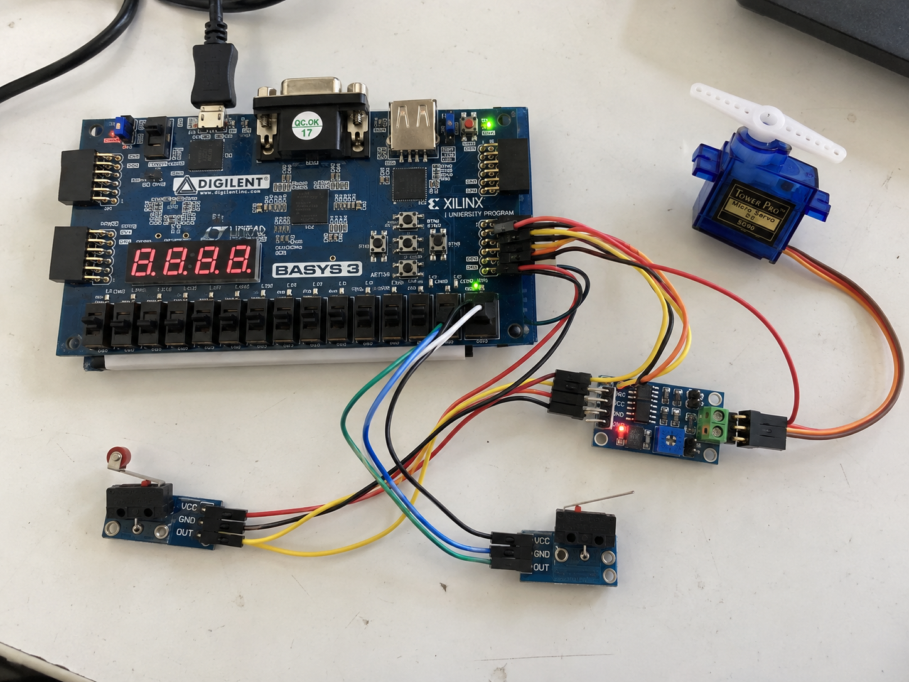

# FPGA Garage Door Controller

This is a small university project where I implemented an automatic garage door controller in **Verilog** using a **Moore finite state machine**.

The design is made for a **Basys 3 FPGA board**. Two sensors are used to detect when the door reaches the top or bottom position. A push button starts the movement, and the FPGA sends `Up_M` or `Dn_M` to an external motor/servo controller.



## How it works

The FSM has 3 states:

- `IDLE` - motor is stopped
- `Mv_Up` - open the door
- `Mv_Dn` - close the door

The inputs are:

- `Activate` - push button
- `Up_Max` - upper position sensor
- `Dn_Max` - lower position sensor
- `RST` - active-low reset

The outputs are:

- `Up_M` - command to move the door up
- `Dn_M` - command to move the door down

When the door is closed (`Dn_Max = 1`) and the button is pressed, the controller goes to `Mv_Up`. When `Up_Max` becomes 1, it returns to `IDLE`.

If the door is open (`Up_Max = 1`) and the button is pressed, the controller goes to `Mv_Dn`. When `Dn_Max` becomes 1, it returns to `IDLE`.

## Repository

```text
rtl/
  Door_Controller.v

sim/
  Door_Controller_tb.v

constraints/
  Basys3.xdc

docs/
  setup.png
```

## Basys 3 connections

| Signal | Basys 3 connection |
|---|---|
| `CLK` | 100 MHz board clock |
| `RST` | SW15 |
| `Activate` | Center push button |
| `Up_Max` | Pmod JA1 |
| `Dn_Max` | Pmod JA2 |
| `Up_M` | Pmod JA3 |
| `Dn_M` | Pmod JA4 |

The two sensor outputs should be **3.3 V logic compatible**.

`Up_M` and `Dn_M` are only control signals. The motor/servo should be powered and controlled through an external driver/controller, not directly from an FPGA pin.

## Running it in Vivado

1. Create a new RTL project for the Basys 3 (`xc7a35tcpg236-1`).
2. Add `rtl/Door_Controller.v` as a design source.
3. Add `sim/Door_Controller_tb.v` as a simulation source.
4. Add `constraints/Basys3.xdc` as the constraints file.
5. Run behavioral simulation first.
6. Run synthesis and implementation.
7. Generate the bitstream.
8. Open Hardware Manager and program the Basys 3.

The provided testbench uses a **50 MHz simulated clock**, while the Basys 3 hardware clock is **100 MHz**. This controller does not use any time delays or counters, so the FSM can run directly from the board clock.

## Tools

- Verilog
- Xilinx/AMD Vivado
- Digilent Basys 3
- Two position sensors
- External motor/servo controller
